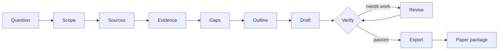
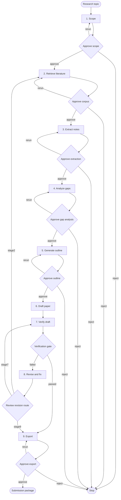
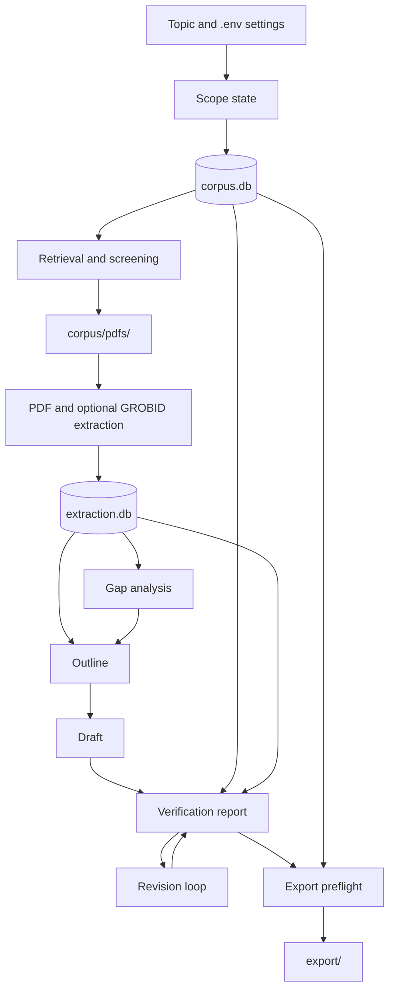

# AI Research Paper Pipeline

> **From research question to evidence-checked paper package.**

An evidence-aware, human-in-the-loop workflow for literature-based research. It scopes a topic, retrieves sources, extracts evidence, identifies gaps, drafts a paper, verifies claims, revises weak sections, and exports submission artifacts.


The application uses [LangGraph](https://langchain-ai.github.io/langgraph/), an OpenRouter-compatible chat model, SQLite state stores, and LaTeX/PDF/BibTeX export tooling. It is designed for assisted research workflows, **not unsupervised publication**.

> [!IMPORTANT]
> Generated text and citations still require expert review. Verification is a quality gate, not a guarantee of factual correctness, originality, or acceptance by a venue.

## Start here

| I want to... | Go to |
| --- | --- |
| Install and run the pipeline | [Quick start](#quick-start) |
| Understand the nine stages | [Pipeline stages](#pipeline-stages) |
| See the workflow visually | [Workflow](#workflow) |
| Configure models and limits | [Configuration](#configuration) |
| Understand generated files | [Outputs](#outputs) |

<details open>
<summary><strong>Documentation menu</strong></summary>

- [What it does](#what-it-does)
- [Workflow](#workflow)
- [Pipeline stages](#pipeline-stages)
- [Control flow and approval gates](#control-flow-and-approval-gates)
- [Data flow and storage](#data-flow-and-storage)
- [Requirements](#requirements)
- [Quick start](#quick-start)
- [Configuration](#configuration)
- [Running the pipeline](#running-the-pipeline)
- [Outputs](#outputs)
- [Project structure](#project-structure)
- [License](#license)

</details>

## What it does

Given a topic, the pipeline:

1. Defines a research scope and screening criteria.
2. Searches for relevant literature and builds a local corpus.
3. Extracts structured notes and evidence from sources.
4. Identifies research gaps.
5. Proposes a paper outline and contribution map.
6. Drafts the paper from the approved research state.
7. Audits claims, citations, numbers, attribution, consistency, overlap, and placeholders.
8. Revises failed or weak sections through bounded fix loops.
9. Produces a formatted export package after final approval.

The stages are connected by explicit state transitions. Human approval gates allow the researcher to inspect results before downstream work begins.

## Workflow



<details>
<summary><strong>What makes the workflow different?</strong></summary>

- **Evidence-first drafting:** the outline and draft are grounded in extracted source notes.
- **Human checkpoints:** the researcher can approve, rerun, or reject intermediate results.
- **Verification before export:** citations, claims, numbers, overlap, and placeholders are checked before formatting.
- **Bounded revision:** verification failures route to targeted revision loops instead of silently passing through.
- **Reproducible local state:** source metadata and extracted notes are kept in SQLite for inspection and reuse.

</details>

## Pipeline stages



<details open>
<summary><strong>Stage details</strong></summary>

| Stage | Module | Inputs | Main result |
| ---: | --- | --- | --- |
| 1 | `scope.py` | Topic, paper type, venue, deadline | Scope, research questions, inclusion/exclusion criteria |
| 2 | `retrieval.py` | Approved scope and search criteria | Screened literature corpus and source metadata |
| 3 | `extraction.py` | Corpus PDFs and metadata | Structured notes, quotations, methods, results, and limitations |
| 4 | `gap_analysis.py` | Extracted notes and corpus | Candidate gaps ranked for relevance and evidence |
| 5 | `outline.py` | Approved gaps and notes | Section plan, claims, contributions, and source mapping |
| 6 | `drafting.py` | Outline and extracted evidence | Draft sections with citation keys |
| 7 | `verification.py` | Draft, outline, corpus, notes | `VerificationReport` with verdicts, issues, pass rate, and fix list |
| 8 | `revision.py` | Draft and verification report | Revised draft and a route back to verification or earlier stages |
| 9 | `export.py` | Approved revised draft and corpus | Preflight report and formatted output package |

</details>

## Control flow and approval gates

Stages 1–5 and stage 9 pause for an explicit decision. The CLI displays the available options and accepts a decision at the prompt:

```text
approve
rerun
reject
```

Stage 8 can route the workflow to:

```text
approve  -> export
stage2   -> retrieve literature again
stage7   -> verify the revised draft again
stage9   -> export again
```

Verification is intentionally stricter than a simple model review. The implementation checks:

- Citation existence and screening status
- DOI metadata and title/year consistency where available
- Sentence-level support and supporting quotations
- Citation attribution and possible citation swaps
- Hedging calibration for weak evidence
- Numeric and cross-section consistency
- Contribution delivery
- New citations introduced in conclusions
- N-gram overlap with source text
- Remaining placeholders or unsupported first-person results

The report records supported, partial, unsupported, and contradicted sentence verdicts, plus a gate status and actionable fixes.

## Data flow and storage



<details>
<summary><strong>Local data policy</strong></summary>

The following are runtime artifacts and are ignored by Git:

- `corpus.db`
- `extraction.db`
- `revision_versions.db`
- `.cache/`
- `corpus/pdfs/`
- `export/`
- `venv/`

Deleting these files can remove local research state, downloaded papers, or generated outputs. Back them up separately if they are valuable.

</details>

## Requirements

- Python 3.10 or newer
- Windows PowerShell, macOS/Linux shell, or an equivalent Python environment
- An [OpenRouter API key](https://openrouter.ai/)
- Internet access for model calls and literature/metadata services
- Optional: a [Semantic Scholar API key](https://www.semanticscholar.org/product/api)
- Optional: a local [GROBID](https://github.com/kermitt2/grobid) server for enhanced PDF extraction
- Optional: a working LaTeX installation if the export implementation compiles LaTeX locally

## Quick start

### Windows PowerShell

```powershell
py -3 -m venv venv
.\venv\Scripts\Activate.ps1
python -m pip install --upgrade pip
python -m pip install -r requirements.txt
Copy-Item .env.example .env
```

If PowerShell blocks activation, either allow scripts for the current user or invoke the interpreter directly:

```powershell
Set-ExecutionPolicy -Scope CurrentUser RemoteSigned
```

### macOS/Linux

```bash
python3 -m venv venv
source venv/bin/activate
python -m pip install --upgrade pip
python -m pip install -r requirements.txt
cp .env.example .env
```

Set `OPENROUTER_API_KEY` in `.env` before starting the pipeline. Never commit `.env`.

## Configuration

All settings are read from environment variables. The complete starter configuration is in [.env.example](.env.example).

<details open>
<summary><strong>Model and service settings</strong></summary>

### Model and service settings

| Variable | Default | Description |
| --- | --- | --- |
| `OPENROUTER_API_KEY` | required | Credential for the configured chat model |
| `OPENROUTER_BASE_URL` | `https://openrouter.ai/api/v1` | OpenAI-compatible model endpoint |
| `RESEARCH_MODEL` | `nvidia/nemotron-3-ultra-550b-a55b:free` | OpenRouter model identifier |
| `RESEARCH_EMAIL` | `research-agent@localhost` in code | Contact value used by retrieval services |
| `SEMANTIC_SCHOLAR_API_KEY` | empty | Optional Semantic Scholar credential |
| `USE_GROBID` | `false` | Enable GROBID-backed extraction |
| `GROBID_URL` | `http://localhost:8070` | GROBID service URL |

</details>

<details>
<summary><strong>Storage settings</strong></summary>

### Storage settings

| Variable | Default | Description |
| --- | --- | --- |
| `CORPUS_DB_PATH` | `corpus.db` | SQLite corpus database |
| `EXTRACTION_DB_PATH` | `extraction.db` | SQLite extraction database |
| `PDF_DIR` | `corpus/pdfs` | Downloaded/source PDF directory |
| `OUTPUT_DIR` | `export` | Generated output directory |

</details>

<details>
<summary><strong>Research and export settings</strong></summary>

### Research and export settings

| Variable | Default | Description |
| --- | --- | --- |
| `PAPER_TYPE` | `survey` | Paper type passed into the pipeline |
| `TARGET_VENUE` | empty | Target venue or publication context |
| `PAGE_LIMIT` | `0` | Page limit; zero means no configured limit |
| `DEADLINE` | empty | Optional project deadline |
| `TOP_N_GAPS` | `3` | Number of top gaps to carry forward |
| `TOTAL_WORD_LIMIT` | `8000` | Draft word budget |
| `MAX_REVISION_ROUNDS` | `3` | Maximum revision rounds |
| `MAX_FIX_LOOPS` | `2` | Maximum verification/fix loops |
| `VENUE_TEMPLATE` | `generic` | Export template, such as `ieee`, `acm`, `springer_lncs`, `elsevier`, `arxiv`, or `generic` |
| `PAPER_TITLE` | empty | Optional title |
| `AUTHORS` | empty | Comma-separated author names |
| `CORRESPONDING_EMAIL` | empty | Optional corresponding-author email |
| `GENERATE_DOCX` | `false` | Request DOCX generation |

</details>

## Running the pipeline

Start the interactive workflow:

```powershell
python main.py
```

Then enter a research topic:

```text
What should the research paper investigate? How do retrieval-augmented language models reduce factual errors?
```

At each approval checkpoint, inspect the displayed stage result and enter one of the allowed decisions. The process creates a new in-memory workflow thread for each run and resumes interrupted graph execution using LangGraph commands.

### Example `.env`

```dotenv
OPENROUTER_API_KEY=replace-with-a-new-key
RESEARCH_MODEL=nvidia/nemotron-3-ultra-550b-a55b:free
PAPER_TYPE=survey
TARGET_VENUE=arxiv
TOTAL_WORD_LIMIT=6000
MAX_REVISION_ROUNDS=2
GENERATE_DOCX=false
```

Do not copy real credentials into documentation, issue reports, screenshots, or commits.

## Outputs

The export stage is designed to produce a submission package containing some or all of the following, depending on available data and local tooling:

- Compiled PDF
- LaTeX source
- BibTeX bibliography
- Supplementary/reproducibility bundle
- Optional DOCX
- Export and compilation reports

Export can be blocked by preflight issues such as missing citations, unresolved references, missing figures, or compilation failures. Treat `ready_to_submit` as an application status, not a substitute for a final author review.

## Project structure

```text
.
├── main.py                 # CLI entry point and graph execution
├── scope.py                # Stage 1: scope definition
├── retrieval.py            # Stage 2: literature retrieval and screening
├── extraction.py            # Stage 3: source/note extraction
├── gap_analysis.py         # Stage 4: gap analysis
├── outline.py              # Stage 5: outline generation
├── drafting.py             # Stage 6: draft generation
├── verification.py         # Stage 7: evidence and quality gate
├── revision.py             # Stage 8: revision and fix loops
├── export.py               # Stage 9: formatting and export
├── tools.py                # Shared helpers
├── requirements.txt        # Python dependencies
├── .env.example            # Safe configuration template
├── .gitignore              # Secret and runtime-artifact exclusions
├── corpus.db               # Local runtime database; ignored
├── extraction.db           # Local runtime database; ignored
├── corpus/pdfs/            # Local source PDFs; ignored
└── export/                 # Generated artifacts; ignored
```

## License

No license has been selected for this project yet. Add a license before publishing if you want others to use, modify, or redistribute the code.
 